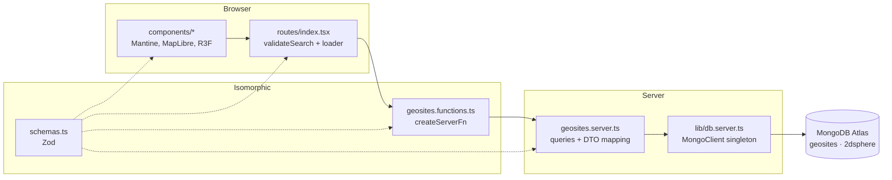

# Architecture

GeoparqueBR is a single TanStack Start package. The same React tree renders on the server (SSR) and hydrates in the browser. Server-only work (MongoDB) is reached through type-safe server functions.

## Layers



| Layer | Files | May import |
| --- | --- | --- |
| UI | `src/features/*/components/*`, `src/routes/*` | schemas, `*.functions.ts`, Mantine/MapLibre/R3F |
| RPC boundary | `*.functions.ts` | schemas, `*.server.ts` (only inside handlers) |
| Server | `*.server.ts`, `src/lib/*.server.ts` | schemas, `mongodb`, `process.env` |
| Shared | `schemas.ts`, `theme.ts` | `zod`, nothing server-only |

The TanStack Start compiler replaces each `createServerFn(...).handler(...)` body with an HTTP stub in the client bundle. The `*.server.ts` import then goes unused there and is tree-shaken out. `mongodb` never reaches the browser; `pnpm build` followed by a grep of `dist/client` confirms it.

## Request lifecycle

What happens on `GET /?lng=-39.6&lat=-7.25&radiusKm=150&site=pedra-cariri`:

```mermaid
sequenceDiagram
  participant B as Browser
  participant R as Router (SSR or client)
  participant F as getNearbyGeosites
  participant M as MongoDB

  B->>R: navigate with search params
  R->>R: validateSearch(ExplorerSearchSchema)<br/>bad values fall back via .catch()
  R->>R: loaderDeps = { lng, lat, radiusKm }<br/>(site is not a dep)
  R->>F: getNearbyGeosites({ data: deps })
  F->>F: .validator(NearbyGeositesQuerySchema)
  F->>M: aggregate([$geoNear, $limit])
  M-->>F: docs + distanceMeters
  F-->>R: GeositeWithDistance[] (toDto)
  R-->>B: render Explorer; drawer opens for ?site
```

- On first load this runs on the server and streams HTML. Later navigations call the server function over HTTP from the client.
- Changing `site` (opening or closing the drawer) does **not** re-run the loader, because `site` is left out of `loaderDeps`.
- "Buscar nesta área", the location form and "Minha posição" all just update search params. The loader does the rest.

## UI composition

```
GeositeExplorer (AppShell)
├── Header: brand, color-scheme toggle
├── Navbar
│   ├── LocationForm      RHF + zodResolver(LocationFormSchema)
│   └── GeositeList       NavLink per geosite, category badges, distance
├── Main
│   └── <ClientOnly> GeositeMap (lazy)   GeoJSON source + circle layer
└── GeositeDrawer         Mantine Drawer, opened by ?site=
    ├── Overview tab
    └── 3D tab → <ClientOnly> ModelViewer (lazy)   R3F Canvas + legend overlay
```

`GeositeExplorer` is presentational. It receives `geosites`, `search` and an `onSearchChange` callback from the route, so the route stays the only owner of URL state.

### Code splitting

| Chunk | Loaded when | Approx. gzip |
| --- | --- | --- |
| App shell (React, Router, Mantine) | always | ~145 kB |
| `GeositeMap` (MapLibre) | after hydration | ~290 kB |
| `maplibre-gl-worker` | when the map starts | separate asset |
| `ModelViewer` (three.js, R3F, drei) | when the 3D tab opens | ~270 kB |

## Adding a feature

To add a new domain area (for example `caves` or `geoparks`):

1. `src/features/<name>/schemas.ts`: Zod schemas for input, DTO and queries.
2. `src/features/<name>/<name>.server.ts`: collection accessor, index definitions, queries, `toDto`.
3. `src/features/<name>/<name>.functions.ts`: `createServerFn` wrappers with `.validator(schema)`.
4. `src/features/<name>/components/`: UI.
5. `src/routes/<path>.tsx`: route with `validateSearch` / `loader` calling the server functions.
6. If the feature needs indexes, register them in `scripts/seed.ts` (or a deploy hook).

Mutations (not implemented yet) should be `createServerFn({ method: "POST" })` with auth enforced **inside the handler or middleware**. Route `beforeLoad` only shapes the UX; it doesn't protect data. After a mutation, call `router.invalidate()`.
