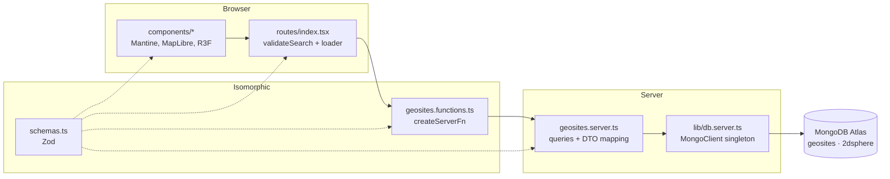
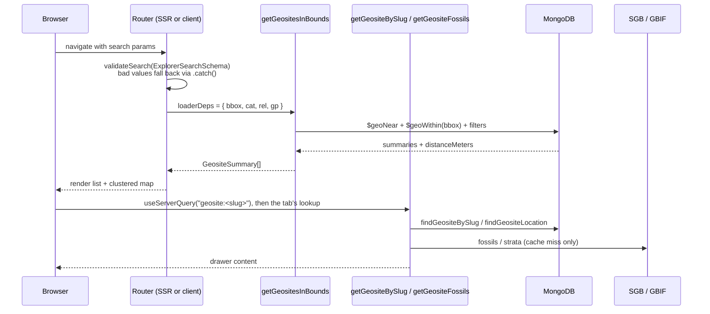
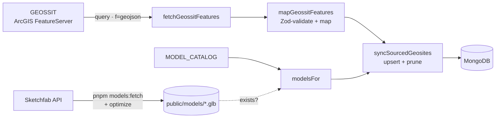

# Architecture

GeoparqueBR is a single TanStack Start package. The same React tree renders on the server (SSR) and hydrates in the browser. Server-only work (MongoDB) is reached through type-safe server functions.

## Layers



| Layer | Files | May import |
| --- | --- | --- |
| UI | `src/features/*/components/*`, `src/routes/*` | schemas, `*.functions.ts`, Mantine/MapLibre/R3F |
| RPC boundary | `*.functions.ts` | schemas, `*.server.ts` (only inside handlers) |
| Server | `*.server.ts`, `src/lib/*.server.ts` | schemas, `mongodb`, `process.env` |
| Shared | `schemas.ts`, `theme.ts` | `zod`, nothing server-only |

The TanStack Start compiler replaces each `createServerFn(...).handler(...)` body with an HTTP stub in the client bundle. The `*.server.ts` import then goes unused there and is tree-shaken out. `mongodb` never reaches the browser; `pnpm build` followed by a grep of `dist/client` confirms it.

## Request lifecycle

What happens on `GET /?bbox=[…]&cat=["paleontological"]&site=pedra-cariri&tab=fossils`:



- On first load the list query runs on the server and streams HTML. Later navigations call the server function over HTTP from the client.
- Panning or zooming the map replaces `bbox` in the URL, which re-runs only the list query. The route sets `pendingMs: Infinity`, so the current list stays on screen meanwhile.
- The drawer and its tabs use [`useServerQuery`](../src/lib/use-server-query.ts), a tiny keyed promise cache. Opening a geosite or switching tabs therefore never re-runs the list loader, and returning to a site is instant.

## Routes

| Path | What |
| --- | --- |
| `/` | map explorer; URL holds `bbox`, filters and drawer state |
| `/geossitios/$slug` | standalone page per geosite: server-rendered overview, 3D and fossils tabs, share and directions buttons, share-preview meta tags and JSON-LD |
| `/sitemap.xml` | server route listing every geosite page |
| `/robots.txt`, `/manifest.webmanifest`, `/sw.js`, `/offline.html`, `/og-default.png`, `/icons/*` | static files in `public/` |

The map drawer and the geosite page render the same `GeositeDetail` and `GeositeActions` (share, "Como chegar", and links between map and page).

## Offline (PWA)

`public/sw.js` registers in production builds only:

| Requests | Strategy | Cache |
| --- | --- | --- |
| `/assets/*` (content-hashed) | cache first | `assets-v1` |
| page navigations | network first; offline: exact URL, any cached copy of the same `/geossitios/…` page, or `/offline.html` | `pages-v1` (60) |
| `/_serverFn/*` GET (geosites, fossils, strata) | network first, cached fallback | `data-v1` (300) |
| OpenFreeMap and SGB geology tiles | stale-while-revalidate | `tiles-v1` (1500) |

**Works offline:** the installed app opens on its start URL with that view's geosites; any geosite page or drawer you've opened before; map tiles you've seen. **Needs a connection:** viewports and geosites you've never loaded. Panning offline shows an empty list instead of the error screen.

## UI composition

```
GeositeExplorer (AppShell)
├── Header: brand, SearchBox (geosites + places), color-scheme toggle
├── Navbar
│   ├── LocationForm      RHF + zodResolver: jump the viewport to a point + radius
│   ├── GeositeFilters    themes / relevance / UNESCO geopark → cat, rel, gp
│   └── GeositeList       summaries in the viewport, nearest to centre first
├── Main
│   ├── <ClientOnly> GeositeMap (lazy)   clustered GeoJSON + SGB geology raster; owns the viewport
│   ├── GeologyLayerControl   toggle (?geo=true) + opacity
│   └── GeologyAtPointCard    unit under a map click (geology layer on)
└── GeositeDrawer         opened by ?site=, loads the full geosite by slug
    ├── Visão geral       GEOSSIT data, photo, scores, credit
    ├── Modelo 3D ─┬─ SketchfabEmbed                iframe, provider: "sketchfab"
    │              ├─ <ClientOnly> ModelViewer      R3F, provider: "gltf"
    │              └─ <ClientOnly> ModelViewer      mapped strata column (or illustrative)
    └── Fósseis           FossilsPanel: SGB + GBIF occurrences within 5 km
```

### Phones (< `sm`, 768 px)

The map is full-screen. The header shows the logo, the search box at full width, and the theme toggle. The sidebar's content (filters, location form, list) moves into `MobileListSheet`, a bottom sheet opened from a floating "N geossítios" button, with filters and location tucked behind a "Filtros e localização" toggle. `GeositeDrawer` becomes a 92% bottom sheet with tabs sharing the width and short labels, and the 3D viewer drops to 320 px. The geology control shrinks to a "Geologia" chip.

Static layout uses Mantine's `hiddenFrom` / `visibleFrom` and responsive style props, which are CSS, so the first paint is correct. `useIsMobile()` (`src/lib/use-is-mobile.ts`) is only for behaviour that CSS can't express, such as drawer position and dropdown width. It returns `false` during SSR.

`GeositeExplorer` is presentational. It receives `geosites`, `search` and an `onSearchChange(next, { replace })` callback from the route, so the route stays the only owner of URL state.

## Data pipeline



`scripts/seed.ts` runs this pipeline. The functions live in `src/features/geosites/*.server.ts` so a scheduled job can reuse them later.

### Code splitting

| Chunk | Loaded when | Approx. gzip |
| --- | --- | --- |
| App shell (React, Router, Mantine) | always | ~145 kB |
| `GeositeMap` (MapLibre) | after hydration | ~290 kB |
| `maplibre-gl-worker` | when the map starts | separate asset |
| `ModelViewer` (three.js, R3F, drei) | when the 3D tab opens | ~270 kB |

## Adding a feature

To add a new domain area (for example `caves` or `geoparks`):

1. `src/features/<name>/schemas.ts`: Zod schemas for input, DTO and queries.
2. `src/features/<name>/<name>.server.ts`: collection accessor, index definitions, queries, `toDto`.
3. `src/features/<name>/<name>.functions.ts`: `createServerFn` wrappers with `.validator(schema)`.
4. `src/features/<name>/components/`: UI.
5. `src/routes/<path>.tsx`: route with `validateSearch` / `loader` calling the server functions.
6. If the feature needs indexes, register them in `scripts/seed.ts` (or a deploy hook).

Mutations (not implemented yet) should be `createServerFn({ method: "POST" })` with auth enforced **inside the handler or middleware**. Route `beforeLoad` only shapes the UX; it doesn't protect data. After a mutation, call `router.invalidate()`.
