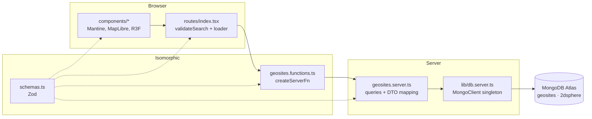
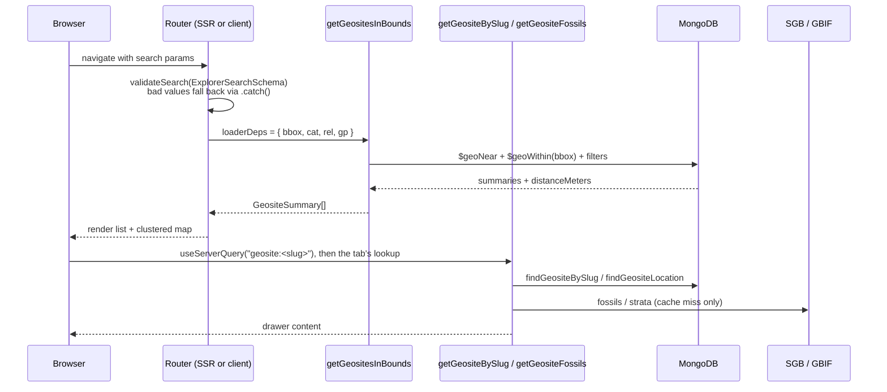
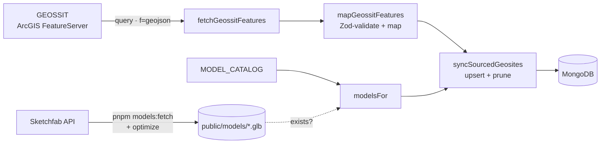

# Architecture

GeoparqueBR is a single TanStack Start package. The same React tree renders on the server (SSR) and hydrates in the browser. Server-only work (MongoDB) is reached through type-safe server functions.

## Layers



| Layer | Files | May import |
| --- | --- | --- |
| UI | `src/features/*/components/*`, `src/routes/*` | schemas, `*.functions.ts`, Mantine/MapLibre/R3F |
| RPC boundary | `*.functions.ts` | schemas, `*.server.ts` (only inside handlers) |
| Server | `*.server.ts`, `src/lib/*.server.ts` | schemas, `mongodb`, `process.env` |
| Shared | `schemas.ts`, `theme.ts` | `zod`, nothing server-only |

The TanStack Start compiler replaces each `createServerFn(...).handler(...)` body with an HTTP stub in the client bundle. The `*.server.ts` import then goes unused there and is tree-shaken out. `mongodb` never reaches the browser; `pnpm build` followed by a grep of `dist/client` confirms it.

## Request lifecycle

What happens on `GET /?bbox=[…]&cat=["paleontological"]&site=pedra-cariri&tab=fossils`:



- On first load the list query runs on the server and streams HTML. Later navigations call the server function over HTTP from the client.
- Panning or zooming the map replaces `bbox` in the URL, which re-runs only the list query. The route sets `pendingMs: Infinity`, so the current list stays on screen meanwhile.
- The drawer and its tabs use [`useServerQuery`](../src/lib/use-server-query.ts), a tiny keyed promise cache. Opening a geosite or switching tabs therefore never re-runs the list loader, and returning to a site is instant.

## Routes

| Path | What |
| --- | --- |
| `/` | map explorer; URL holds `bbox`, filters and drawer state |
| `/geosites/$slug` | standalone page per geosite: server-rendered overview, 3D and fossils tabs, share and directions buttons, share-preview meta tags and JSON-LD |
| `/geoparks` | Brazil's UNESCO Global Geoparks, with designation year, description and GEOSSIT geosite count |
| `/geoparks/$geoparkId` | one geopark: description, its GEOSSIT geosites (matched by municipality), a link that frames its area on the map, JSON-LD `TouristDestination` |
| `/fossils` | fossil genera recorded within 5 km of a geosite, grouped by class (from `fossil_genera`); filters by name, group and geopark live in the URL (`?q=&group=&gp=`) |
| `/fossils/$genus` | one genus: GBIF classification, species recorded, the geosites near its records (no specimen locations), units and ages as recorded, JSON-LD `Taxon` |
| `/news`, `/news.xml` | "Novidades": what each weekly GEOSSIT sync added, changed (by field) or removed, from `geosite_changes`; RSS 2.0 in the URL's language |
| `/stats` | "Números": geosites by relevance, theme, geological period and state, with links to the map filtered over all of Brazil |
| `/timeline` | every geological period, youngest first, in ICS colours, with the geosites whose dated age overlaps it |
| `/geoparks/compare` | the geoparks side by side: counts, relevance, themes, rock ages and fossil genera |
| `/rankings` | the top 25 geosites by a GEOSSIT score (scientific, tourism, didactic or vulnerability), filterable by geopark and state (`?by=&gp=&uf=`); ties share a place |
| `/glossary` | plain-language definitions of the app's terms, themes and scores, with anchors that theme badges and the score section link to |
| `/states`, `/states/$uf` | states with GEOSSIT geosites; one page per state (`/states/pe`) with counts by theme and period, the top scientific values, its geoparks, fossil genera and every geosite, plus a map link framed on the geosites' public points |
| `/regions`, `/regions/$region` | Brazil's five regions; one page per region with its states side by side (geosites, international relevance, geoparks), themes, periods, geoparks and fossil genera |
| `/units`, `/units/$slug` | rock units the SGB map names at geosites (`?q=` filters the list); one page per unit with its mapped age (from geosites where it is the only unit), the geosites on it and fossil genera nearby |
| `/conservation` | geosites at high GEOSSIT degradation risk, most vulnerable first, with guidance on visiting without damage |
| `/my-geosites` | this device's trip, favourites, visits, progress per geopark and offline geoparks (localStorage, `noindex`) |
| `/geoparks/$geoparkId/guide`, `/trip/guide` | printable field guides (`src/features/guide/`): each geosite's full description, age, public coordinates, GEOSSIT source and a QR code for its page (SVG made on the server with `qrcode`); print CSS hides the app chrome and forces light colours (`noindex`) |
| `/embed/geoparks/$geoparkId`, `/embed/geosites/$slug` | embeddable maps for other sites' `<iframe>`s (`src/features/embed/`): public points, a credit bar linking back, cooperative gestures, no app chrome, no service worker, `noindex`; the "Incorporar" button gives the code |
| `/trip` | this device's trip: suggested order, straight-line legs, Google Maps links and a share link; `?stops=a,b,c` opens a shared trip (`noindex`) |
| `/sitemap.xml` | server route listing every page in every language, with hreflang alternates |
| `/og/geosites/$slug`, `/og/geoparks/$geoparkId` | server routes rendering share cards (PNG, cached a week at the CDN), in the locale of the URL (`/en/og/…`) |
| `/robots.txt`, `/manifest.webmanifest`, `/sw.js`, `/offline.html`, `/og-default.png`, `/icons/*` | static files in `public/` |

Every path also exists in English under `/en` and in Spanish under `/es` (`/en/geosites/$slug`, `/es/geosites/$slug`). Routes don't declare the prefix: the router's `rewrite` removes it before matching and adds it to links in the page's language (Paraglide's URL strategy), and `src/server.ts` wraps each request in `paraglideMiddleware` so server rendering uses the same locale.

The map drawer and the geosite page render the same `GeositeDetail` and `GeositeActions` (share, directions, and links between map and page).

## Offline (PWA)

`public/sw.js` registers in production builds only:

| Requests | Strategy | Cache |
| --- | --- | --- |
| `/assets/*` (content-hashed) | cache first | `assets-v7` |
| page navigations | network first; offline: exact URL, any cached copy of the same `/geosites/…`, `/geoparks/…`, `/fossils/…`, `/my-geosites` or `/trip` path (any language), or `/offline.html` (in the page's language) | `pages-v7` (150) |
| `/_serverFn/*` GET (geosites, fossils, strata) | network first, cached fallback | `data-v7` (600) |
| OpenFreeMap and SGB geology tiles | stale-while-revalidate | `tiles-v7` (4000) |
| AWS Terrain Tiles (relief shading, 3D terrain) | stale-while-revalidate | `relief-v7` (2000) |

**Works offline:** the installed app opens on its start URL with that view's geosites; any geosite page or drawer you've opened before; map tiles you've seen; "Meus geossítios"; and everything in a geopark saved with **Salvar para uso offline**. **Needs a connection:** viewports and geosites you've never loaded and didn't save. Photos are never cached.

### Saving a geopark for offline use

The button on each geopark page (`src/features/offline/`) stores, in about 10–20 s:

- **Pages** (geopark, its geosites, `/geoparks`, `/my-geosites`, the map of its area), through a `cache-pages` message to the service worker, which also stores the hashed scripts and styles each page loads.
- **Data**: each geosite's record, fossils, strata and nearby list, by calling the same server functions the drawer calls, so the cached requests match.
- **Map code**: the lazily loaded map chunk and MapLibre's worker.
- **Tiles**: OpenFreeMap vector tiles at map zooms 6–12 and relief tiles at 7–12 over the geopark's `area` (`tileUrls`), about 100–200 of each.
- **Geosites, on the device**: the geopark's geosite list goes into localStorage with the save date. Cached list responses only match their exact viewport, so when the map's list request fails (offline, or a connection that drops requests), the explorer lists saved geosites inside the box instead (`savedGeositesInBounds`).

Saved tiles share their caches with normal browsing and can eventually be evicted; "Atualizar dados offline" saves again.

### On this device: favourites and visits

"Meus geossítios" (`/my-geosites`, not indexed) lists favourites, visits (with the date) and saved geoparks. They live in localStorage (`src/features/my-geosites/store.ts`, via `src/lib/local-store.ts`), each with a small snapshot of the geosite so the list works offline. There is no account and nothing is sent to the server. A geopark's page shows how many of its geosites this device has visited, and "Meus geossítios" lists that progress per geopark.

### Trips

The trip button (beside the star and tick) adds a geosite to a trip kept in localStorage (`src/features/trip/store.ts`, up to 25 stops); a geopark page can add all of its geosites at once. `/trip` orders the stops on the device (`suggestOrder` in `route.ts`: nearest neighbour, then 2-opt), shows straight-line legs and opens the route in Google Maps (`googleMapsTripUrls`, split into legs of 10 points). "Começar da minha posição" uses the browser's location for the ordering and the links only; it never reaches the server. Stops carry each geosite's public point, so sensitive sites are approximate, as in "Como chegar". A share link (`/trip?stops=a,b,c`) carries slugs only; the server resolves them to public points (`getTripStops`). "Roteiro no mapa" (`?trip=true`) draws the trip on the map explorer as a dashed route with numbered stops (`tripFeatures` in `map.ts`); tapping a stop opens its geosite.

### Perto de mim

The map's "Perto de mim" button reads the browser's location once, centres the map there and ranks the listed geosites by straight-line distance from it (`rankFromPoint` in `src/features/geosites/near.ts`, to public points, rounded to 100 m). The position stays in the page's state, shown as a dot; it never reaches the server, and moving the map away from it leaves the mode.

## UI composition

```
GeositeExplorer (AppShell)
├── Header: brand, SearchBox (geosites + places), color-scheme toggle
├── Navbar
│   ├── LocationForm      RHF + zodResolver: jump the viewport to a point + radius
│   ├── GeositeFilters    themes / relevance / UNESCO geopark → cat, rel, gp
│   └── GeositeList       summaries in the viewport, nearest to centre first
├── Main
│   ├── <ClientOnly> GeositeMap (lazy)   clustered GeoJSON + SGB geology raster; owns the viewport
│   ├── GeologyLayerControl   toggle (?geo=true) + opacity
│   └── GeologyAtPointCard    unit under a map click (geology layer on)
└── GeositeDrawer         opened by ?site=, loads the full geosite by slug
    ├── Visão geral       GEOSSIT data, photo, scores, credit
    ├── Modelo 3D ─┬─ SketchfabEmbed                iframe, provider: "sketchfab"
    │              ├─ <ClientOnly> ModelViewer      R3F, provider: "gltf"
    │              └─ <ClientOnly> ModelViewer      mapped strata column (or illustrative)
    └── Fósseis           FossilsPanel: SGB + GBIF occurrences within 5 km
```

### Phones (< `sm`, 768 px)

The map is full-screen. The header shows the logo, the search box at full width, and the theme toggle. The sidebar's content (filters, location form, list) moves into `MobileListSheet`, a bottom sheet opened from a floating "N geossítios" button, with filters and location tucked behind a "Filtros e localização" toggle. `GeositeDrawer` becomes a 92% bottom sheet with tabs sharing the width and short labels, and the 3D viewer drops to 320 px. The geology control shrinks to a "Geologia" chip.

Static layout uses Mantine's `hiddenFrom` / `visibleFrom` and responsive style props, which are CSS, so the first paint is correct. `useIsMobile()` (`src/lib/use-is-mobile.ts`) is only for behaviour that CSS can't express, such as drawer position and dropdown width. It returns `false` during SSR.

`GeositeExplorer` is presentational. It receives `geosites`, `search` and an `onSearchChange(next, { replace })` callback from the route, so the route stays the only owner of URL state.

## Data pipeline



`scripts/seed.ts` runs this pipeline. The functions live in `src/features/geosites/*.server.ts` so a scheduled job can reuse them later.

### Code splitting

| Chunk | Loaded when | Approx. gzip |
| --- | --- | --- |
| App shell (React, Router, Mantine) | always | ~145 kB |
| `GeositeMap` (MapLibre) | after hydration | ~290 kB |
| `maplibre-gl-worker` | when the map starts | separate asset |
| `ModelViewer` (three.js, R3F, drei) | when the 3D tab opens | ~270 kB |

## Adding a feature

To add a new domain area (for example `caves` or `geoparks`):

1. `src/features/<name>/schemas.ts`: Zod schemas for input, DTO and queries.
2. `src/features/<name>/<name>.server.ts`: collection accessor, index definitions, queries, `toDto`.
3. `src/features/<name>/<name>.functions.ts`: `createServerFn` wrappers with `.validator(schema)`.
4. `src/features/<name>/components/`: UI.
5. `src/routes/<path>.tsx`: route with `validateSearch` / `loader` calling the server functions.
6. If the feature needs indexes, register them in `scripts/seed.ts` (or a deploy hook).

Mutations (not implemented yet) should be `createServerFn({ method: "POST" })` with auth enforced **inside the handler or middleware**. Route `beforeLoad` only shapes the UX; it doesn't protect data. After a mutation, call `router.invalidate()`.
